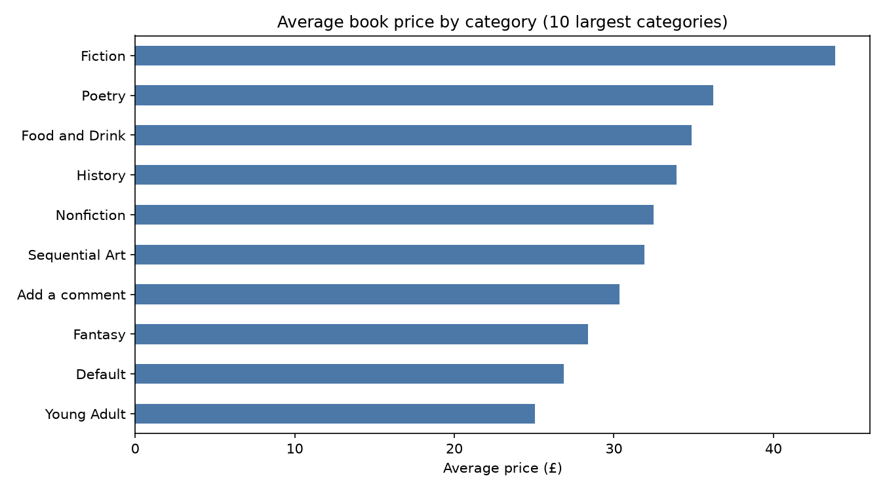
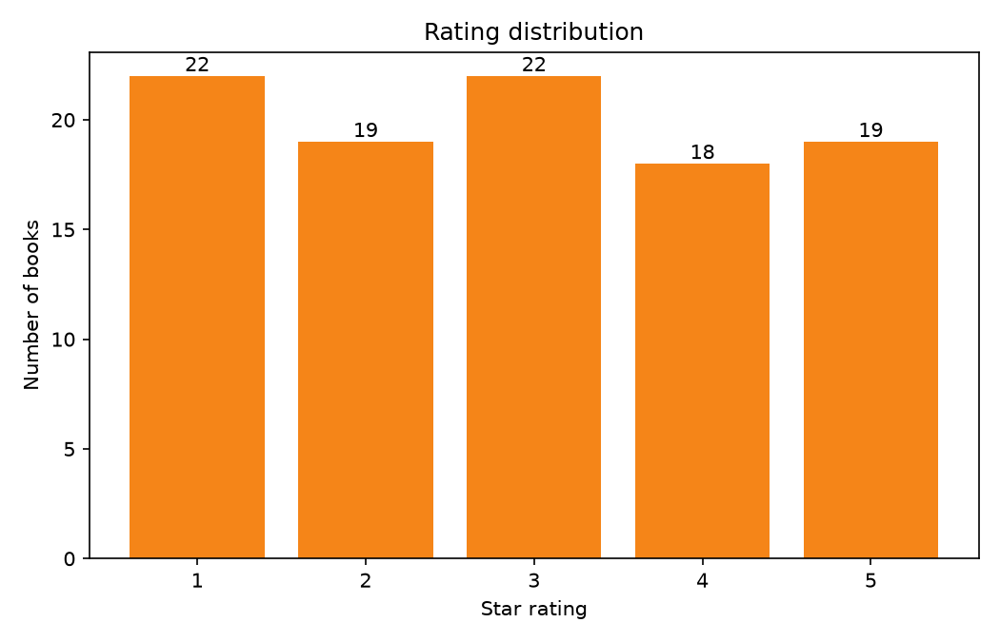

# BookPulse

A small end-to-end data pipeline: **scrape → clean → load → enrich with an LLM → serve via API → visualize**, all runnable with Docker.

BookPulse scrapes 100 books from [books.toscrape.com](https://books.toscrape.com) (a site built for scraping practice), cleans and validates the data with pandas, loads it into a relational PostgreSQL schema, uses an LLM to summarize each description and label its target audience (with automatic quality checks), and exposes the results through a FastAPI REST API.

**Tech stack:** Python, BeautifulSoup, pandas, SQLAlchemy, PostgreSQL, FastAPI, Google Gemini API, matplotlib, Plotly, Docker, Git

---

## Architecture

```
books.toscrape.com
        |
        v
  scrape.py        Extract: requests + BeautifulSoup -> data/raw.json
        |
        v
  clean.py         Transform: pandas cleaning + assert-based validation -> data/clean.csv
        |
        v
  load.py          Load: PostgreSQL (categories, books) with PK/FK constraints
        |
        v
  enrich.py        LLM step: Gemini summary + audience label, validated -> book_insights
        |
        +-----------------------+
        v                       v
  api.py (FastAPI)        charts.py (matplotlib / Plotly)
  runs in Docker          writes to charts/
```

### Database schema

```
categories (category_id PK, name UNIQUE)
     ^
     |  FK
books (book_id PK, title, price, rating CHECK 1-5, stock, description, url UNIQUE, category_id FK)
     ^
     |  FK (also PK)
book_insights (book_id PK/FK, summary, audience, model, created_at)
```

---

## Project structure

```
bookpulse/
├── scrape.py              # Extract
├── clean.py               # Transform + validate
├── load.py                # Load into PostgreSQL
├── enrich.py              # LLM enrichment with quality checks
├── api.py                 # FastAPI service
├── charts.py              # Charts
├── Dockerfile
├── docker-compose.yml     # PostgreSQL + API
├── requirements.txt
├── data/                  # raw.json, clean.csv
├── charts/                # generated charts
└── screenshots/           # images used in this README
```

---

## Setup

### Prerequisites
- Python 3.10+
- Docker Desktop (running)
- A free Gemini API key from [Google AI Studio](https://aistudio.google.com/apikey)

### 1. Clone and create a virtual environment

```bash
git clone https://github.com/ridmisamarasundara/bookpulse.git
cd bookpulse
python -m venv venv
venv\Scripts\activate          # Windows (Mac/Linux: source venv/bin/activate)
pip install -r requirements.txt
```

### 2. Add your API key

Create a `.env` file in the project root (it is git-ignored):

```
GEMINI_API_KEY=your_key_here
```

Optional: set `GEMINI_MODEL=<model name>` to override the default model.

### 3. Start the database

```bash
docker compose up -d db
```

### 4. Run the pipeline (in order)

```bash
mkdir data
python scrape.py      # ~2 minutes, saves data/raw.json
python clean.py       # validates and saves data/clean.csv
python load.py        # creates tables and loads 100 books (drops existing tables first)
python enrich.py      # LLM summaries + audience labels (resumable)
python charts.py      # saves charts to charts/
```

### 5. Start the API

```bash
docker compose up -d --build
```

Open **http://localhost:8000/docs** for the interactive Swagger UI.

---

## API endpoints

| Method | Path | Description |
|---|---|---|
| GET | `/health` | Checks that the API can reach the database |
| GET | `/books` | List books. Filters: `category`, `audience`, `min_rating`, `limit` |
| GET | `/books/{book_id}` | One book with its LLM summary; returns 404 if not found |
| GET | `/stats/categories` | Book count, average price and average rating per category |
| GET | `/stats/audiences` | Number of books per LLM-assigned audience label |

Example:

```bash
curl "http://localhost:8000/books?category=Poetry&min_rating=3&limit=5"
```

### Screenshots

<!-- Save your screenshots in the screenshots/ folder using these names, or edit the paths. -->


---

## Charts

Generated by `charts.py` into `charts/`:

- `avg_price_by_category.png`: average price for the 10 largest categories
- `rating_distribution.png`: number of books per star rating
- `audience_labels.png`: audience labels assigned by the LLM
- `price_vs_rating.html`: interactive Plotly scatter plot (open in a browser)




---

## Data quality and LLM output checks

### Cleaning and validation (`clean.py`)
Prices are converted from text (`£51.77`) to numbers, rating words (`Three`) to integers, and stock sentences (`In stock (22 available)`) to numbers. Duplicates are removed by URL. The script then runs `assert` checks (no null titles, unique URLs, price > 0, rating between 1 and 5, stock parsed, category present) and stops if any check fails, so bad data never reaches the database.

### LLM validation (`enrich.py`)
For each book the model returns JSON with a one-sentence `summary` and an `audience` label. Every item is validated:
- `audience` must be one of `children`, `teens`, `adults`, `general`
- `summary` must be non-empty and at most 30 words
- items that fail are retried once; the rest are counted as failed and left out of the database

Books are sent **10 per request** to stay within free-tier rate limits, and the script is resumable (it skips books that already have insights).

### Results

<!-- UPDATE these numbers after your final enrich.py run. -->

| Metric | Value |
|---|---|
| Books scraped | 100 |
| Books enriched | XX / 100 |
| Passed validation on first try | XX / XX |
| Passed after one retry | XX / XX |
| Failed validation | XX / XX |
| Model | gemini-3.5-flash |

---

## Design decisions

- **Batch ETL, not streaming.** The source is a static site and the data is small, so a scheduled or manual batch run is the simplest correct choice. Streaming (for example Kafka) would make sense if records arrived continuously.
- **PostgreSQL with a normalized schema.** Categories live in their own table, referenced by a foreign key, which avoids repeating text and lets the database enforce integrity. A data warehouse would be overkill at this size; it would fit better if analytics across many large sources were the main goal.
- **Fail loudly on bad data.** Validation uses assertions so problems are caught at the earliest step instead of surfacing later in the API or charts.
- **LLM output is untrusted.** The model's response is parsed and checked against rules before storage. Invalid output is retried once, then skipped, never stored.
- **Batching and resumability for the LLM step.** Sending multiple books per request cut API calls roughly tenfold to fit free-tier limits, and saving each batch immediately means a quota error loses no progress.
- **Parameterized SQL in the API.** All queries use bound parameters instead of string formatting to avoid SQL injection.
- **`LEFT JOIN` for insights.** Books without an LLM summary still appear in the API, with `null` summary fields.
- **Docker Compose.** The database and API start with one command, and the API reaches the database by service name (`db`) using the `DATABASE_URL` environment variable.

---

## Limitations and future improvements

- Schedule the pipeline with **Apache Airflow** instead of running scripts by hand.
- Use **Playwright** to scrape JavaScript-rendered sites.
- Add **automated tests** (pytest) for the cleaning functions and API endpoints.
- Add response models (Pydantic) so the API docs show real example responses.
- Run the pipeline scripts as containers too, not only the API.
- Use database migrations (for example Alembic) instead of dropping and recreating tables in `load.py`.
- The LLM step uses a free tier with daily quotas, so a full run may need to be split across days. The code is structured so that switching providers only requires changing the `call_model()` function.

---

## Author

Ridmi Samarasundara. [GitHub](https://github.com/ridmisamarasundara) · [LinkedIn](https://linkedin.com/in/ridmi-samarasundara-361934327)